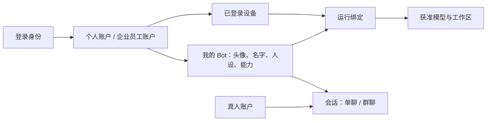

# AgentOS 账号、Bot 与统一会话设计 v0.1

日期：2026-11-04。状态：设计草案；本轮只编写设计，不表示账号、Bot 同步或新聊天协议已实现。

## 1. 本轮目标与已确认方向

- 用户可创建一个或多个 Bot，设置头像、名称、简介、人设及能力。
- 支持与 Bot 单聊，也支持将 Bot 和真人邀请到群聊。
- Bot 归属账号，可跨设备使用。用户已明确选择这一方向。
- 消息区与输入框沿用现有单聊视觉；@ 候选参考提供的截图，显示头像、名称、类型与可用状态。
- 将账号体验作为前置建设，而不是仅修改 @ 下拉框。

以下交互、默认值、接口与交付阶段是本稿建议，尚不代表上线承诺。既有个人/企业账户隔离及资源授权边界继续适用。

## 2. 当前实现与缺口

本次以源码检查为依据，没有启动认证服务、访问生产数据库或重新进行登录验收。

| 范围 | 本次发现 | 对本轮的影响 |
| --- | --- | --- |
| 桌面 Agent 配置 | `AppSettings.agents` 是 SDK 子代理定义，含 name/description/prompt/tools/model | 可复用配置字段，但不能直接当作拥有头像、稳定身份和会话列表的 Bot |
| 群内 Agent | `RoomSeat` 有房间内 id、人设、模型、技能、AI 来源和工作区执行者 | 可承接 Bot 的运行绑定；群席位不能充当跨群 Bot 主身份 |
| @ 提及 | 候选来自当前房间 seats；提及保存 seatId 和文字区间 | 保留显式 ID 与编辑校验，扩展候选对象，不能改为按昵称匹配执行 |
| 认证服务 | 当前项目内 `AgentOS-Server/crates/agentos-identity` 已注册 Web login/callback/me/logout；已有 Keycloak 适配与稳定身份映射源码 | 沿用认证基础，补桌面原生登录、账户选择和设备登记；Web Cookie 接口不等于桌面接入已完成 |
| 账户设计 | 既有方案区分登录身份、个人账户和企业员工账户 | Bot 所有权使用 account_id，不使用邮箱、机器名或临时群 userId |
| 两个服务端检出 | `D:/gitrep/AgentOS/AgentOS-Server` 已有 workspace 认证模块；`D:/gitrep/AgentOS-Server` 保留较早单工程结构 | 实施前选定同一服务端版本，不跨两个目录混合改造；本稿以当前 AgentOS 项目内的服务端源码为核查依据 |

可复核源码：桌面 `packages/shared/src/models.ts`、`packages/shared/src/room-protocol.ts`、`apps/desktop/electron/main/session-manager.ts`、`apps/desktop/electron/main/room-service.ts`、`apps/desktop/src/lib/room-mention-draft.ts`；服务端 `crates/agentos-identity/src/api.rs` 与 `docs/api/authentication.md`。

## 3. 产品对象



界面以「人、Bot、聊天」组织。高级运行设置才展示模型来源、设备和项目目录；不要求用户先理解席位、执行器或 SDK 子代理。

| 对象 | 稳定标识与关系 | 规则 |
| --- | --- | --- |
| 登录身份 | openid；关联已验证 issuer + subject | 用于证明是谁，不直接赋予企业资源权限；不因邮箱相同自动合并 |
| 业务账户 | account_id；个人，或某企业员工 | Bot、群成员和业务数据按此账户归属；企业身份含 tenant_id |
| 设备 | device_id；设备登记与当前账户会话分别记录 | 同一人可有多台设备；换电脑不会创建新 Bot；设备可被撤销 |
| Bot | bot_id + owner_account_id + revision | 独立资产，一个账户可创建多个；跨聊天复用身份和已发布设定 |
| 会话 | conversation_id + kind=direct/group | 持久化消息及成员关系；单聊也有明确参与方 |
| 会话成员 | participant_id；account_id 或 bot_id，二者择一 | 保存加入/退出、角色及可读历史边界；Bot 同名不影响寻址 |
| Bot 会话运行 | conversation_id + bot_id + execution binding | 同一 Bot 在不同会话使用独立上下文和任务状态 |

Bot 身份、会话和运行进程分开：删除设备不会删除 Bot；把 Bot 移出群聊不会删除它；删除 Bot 不删除历史消息。

## 4. 账号首版体验

建议主入口：未登录时显示「登录 / 创建账号」和「继续本机使用」；已有本机聊天仍可访问，不因引入账号阻断原有工作。

首次使用流程：

1. 点击登录，系统浏览器打开统一身份页面，完成邮箱注册、邮箱验证及密码登录。
2. 返回桌面，展示已关联账户；首次明确选择「个人使用」时幂等创建至多一个个人账户。
3. 填写或确认昵称、头像。显示名可以修改，历史资源归属仍按稳定 ID。
4. 登记当前设备，允许用户修改设备名称；默认不开放远程文件执行。
5. 进入会话列表，可「创建 Bot」「开始单聊」「创建群聊」。

账户入口显示当前头像、昵称和个人/企业身份。账户中心包含个人资料、身份切换、登录设备、退出当前设备、退出所有设备与认证安全入口。

企业员工仍走现有邀请/认领/激活规则。登录个人账户不会取得同一人的企业 Bot 或群消息；切换账户会更换聊天列表、Bot 列表、缓存和运行授权上下文。

首版建议沿用既有邮箱验证＋密码登录方案、手机号按需绑定及高权限身份的认证强度要求。恢复与找回遵守既有认证基线，不另外设计仅靠邮箱相同即可接管身份的路径。

## 5. 登录与设备接入

- 复用 Keycloak 处理认证，AgentOS 负责身份映射、业务账户、设备、业务会话及授权。
- 桌面使用公共客户端 Authorization Code + PKCE，经系统浏览器与受限回调完成；不在安装包内嵌共享 client secret。原生应用授权方式参见 [RFC 8252](https://www.rfc-editor.org/rfc/rfc8252)。
- OIDC 主体按已验证 issuer + subject 映射；邮箱不作为永久主键。参见 [OIDC Claim Stability](https://openid.net/specs/openid-connect-core-1_0.html#ClaimStability)。
- 令牌由主进程管理，刷新凭据使用操作系统保护存储。渲染层只获取登录状态和公开资料，聊天消息、日志及 Bot 配置不携带令牌。
- 登录身份会话与业务账户会话分开。后者固定 account_id；企业账户还固定 tenant_id，服务器从已验证会话推导范围，不接受客户端任意声明所有者。
- 设备登记不等于文件访问授权。执行仍须具备具体模型、工作区及工具权限；旧会话和撤销设备不能靠重连恢复权限。
- 注销/撤销须同时处理平台会话与 IdP 认证状态；撤销期间阻止旧认证材料立即重建业务会话，沿用安全版本与认证时间检查。

现有 Web 路由保持原语义：`GET /api/v1/auth/login`、`GET /api/v1/auth/callback`、`GET /api/v1/auth/me`、`POST /api/v1/auth/logout`。原有后台接口与桌面原生登录适配分开验收。

## 6. 我的 Bot

「我的 Bot」提供卡片/列表、创建、编辑、开始聊天、邀请进群、停用与删除入口。

基础创建表单只要求：头像（可选）、名字、人设。简介可选。创建后立即可打开单聊；若尚无模型配置，明确引导配置可用模型。

高级设置折叠展示：默认模型或 AI 资源引用、Skills/MCP 能力、允许的工作区、可用执行设备。界面不展示或同步原始模型密钥。

建议持久字段：`bot_id`、`owner_account_id`、`name`、`avatar_asset_id`、`description`、`instructions`、`default_model_ref`、`capability_refs`、`visibility`、`status`、`revision`、时间戳。`visibility` 首版支持本人可见和明确授权会话内可用。

运行配置使用独立 binding：Bot、设备、AI 资源、工作区授权及状态。一个 Bot 的多个设备绑定由调度端选择，不把某个 Windows 目录写成所有设备通用的 Bot 配置。

修改设定生成版本；新任务使用最新有效版本，在途任务继续使用创建时快照。昵称与头像变更不创建新成员，消息保留发送时的身份快照与 bot_id。修改/删除 Bot 由所有者或获得相应权限者操作；群管理员可以移出 Bot，但不能直接改写别人持有的 Bot 人设。

Bot 列表应区分「可用」「没有在线运行设备」「需要配置模型」「已停用」。账号同步成功不等于 Bot 常驻运行；首版按已授权的在线客户端执行，不承诺电脑关闭后自动改用云端。

## 7. 单聊、群聊与 @

左侧以会话为主，新建菜单提供「新建聊天」「创建群聊」「创建 Bot」。我的 Bot 独立入口用于管理资产，群成员面板用于查看当前会话参与者。

- 真人 ↔ Bot：普通发送由当前 Bot 回复，无需每次 @。
- 真人 ↔ 真人：普通直接聊天。
- 群聊：真人和 Bot 都可成为成员，Bot 通过明确 @ 或回复该 Bot 消息被调用；未定向普通消息不默认启动所有 Bot。
- 单聊中邀请第三个参与者时创建新群，原私聊保留；明确选择要带入的消息，默认不公开整个私聊历史。
- 同一个 Bot 加入多个群，设定可复用，聊天上下文与会话记忆相互独立；长期记忆的共享必须另有明确来源与权限。

@ 菜单建议：

```text
@ 所有人                      通知
本会话
  [头像] Johnny               真人
  [头像] 设计助手             Bot
  [头像] 审核助手             Bot · 暂不可用
添加到会话
  [头像] 我的另一个 Bot       邀请加入
```

- 输入后按名字/简介筛选，方向键选择、Enter/Tab 确认、Escape 关闭；鼠标选择不丢光标，支持多个显式提及。
- 已选对象展示可辨识的 @ 标签，内部保存类型和稳定 ID；重命名、同名、粘贴普通字符串不能误触发另一个对象。
- 「本会话」只列当前可见成员；从「添加到会话」选择时先执行加入流程，成功后才插入有效提及。搜索不暴露无权限的私人 Bot。
- `@所有人` 表示群通知，不等于让每个 Bot 自动运行。若以后增加「让多个 Bot 同时回答」，使用独立且清楚的动作。
- 插件按能力入口独立分区，只有确实实现 @ 调用的插件才列入，并显示连接/授权状态；不会把插件冒充群成员。
- Bot 输出里的普通 @ 文字不自动触发其他 Bot。已有显式任务委派能力继续经调度规则执行，避免把展示标签变成隐式循环调用。

## 8. 同步与数据边界

| 内容 | 建议位置与同步方式 |
| --- | --- |
| 账户资料、Bot 资料及版本、会话成员关系 | 服务端权威，按 account_id 与权限读取，桌面保留分账户缓存 |
| 头像、附件 | 受控对象存储；资料保存 asset_id，访问时授权解析，限制类型与大小 |
| 云会话消息 | 服务端排序与持久化；全局消息 ID、会话顺序号、客户端请求 ID，重连按游标补齐 |
| 原有本机聊天 | 保持本机；用户选择迁入账号后再上传，不在首次登录时静默全量同步 |
| 模型凭据、个人原生认证、项目文件 | 留在原授权执行位置；账号登录和 Bot 同步不自动上传或分享 |
| 执行过程与恢复信息 | 运行设备保留本地执行状态，服务端记录可共享任务状态和结果；按执行尝试与幂等规则恢复 |

Bot 编辑使用 revision/If-Match 检测并发修改，冲突返回当前版本，避免两台设备静默覆盖。群消息由服务端下发权威 sender/member 信息；客户端不能通过提交 bot_id 伪装 Bot。群成员撤销后，历史读取、附件和增量订阅同步停止授权。

## 9. 接口职责草案

下表为新增契约建议，不表示当前存在这些路由。落地时先与服务端已有账户/企业 API 核对命名及模型，再形成 OpenAPI 与新增迁移；不修改已应用迁移的原文。

| 路由/职责建议 | 关键输入与输出 | 权威范围 |
| --- | --- | --- |
| `POST /api/v1/auth/desktop/sessions` | 经验证的桌面 OIDC 认证材料、设备登记信息 → 登录会话、本人身份和账户列表 | 校验发行方、客户端/受众、认证时间与设备状态；ID Token 不作为一般资源访问令牌 |
| `POST /api/v1/accounts/personal` | 登录会话、本人明确开通操作 → personal account_id | 幂等，身份下至多一个；不由 Bot 创建隐式开通 |
| `POST /api/v1/account-sessions` | 登录会话、目标 account_id → 固定账户的业务会话 | 校验本人账户关系、企业/账户状态与所需认证强度 |
| `GET/PATCH /api/v1/profile` | 当前身份/账户资料 → 昵称、头像等公开资料 | 区分全局登录资料与企业员工资料，不越权互改 |
| `GET /api/v1/devices`、`POST /api/v1/devices/{id}/revoke` | 设备列表、本人撤销操作 | 所有者及适用重新认证；撤销后不能领取新任务 |
| `GET/POST /api/v1/bots`、`PATCH /api/v1/bots/{id}` | Bot 资料、revision → 稳定 bot_id 和新版本 | 所有者由会话推导，不接受任意 owner_account_id |
| `POST /api/v1/conversations` | direct/group、参与者引用 → 会话与成员 | 参与者准入、Bot 使用授权；创建不自动授予历史可见权 |
| `POST /api/v1/conversations/{id}/invitations` | 目标账户/Bot、邀请范围 → 邀请状态 | 真人明确接受；Bot 所有者授权＋群准入，两者均满足后生效 |
| `GET /api/v1/conversations/{id}/mention-candidates` | 查询词/分页 → 当前成员及本人可邀请 Bot 的分类候选 | 每次查询按当前权限过滤；结果不含人设、凭据或私人资料 |
| `POST /api/v1/conversations/{id}/messages` | client_message_id、正文、提及引用、引用消息/附件 ID → 消息 ID、seq、接收状态 | 校验发送者、成员状态、提及对象与引用权限；接收成功与 Bot 执行成功分开 |

业务错误至少区分未登录、账户不可用、无会话权限、Bot 暂不可用、版本冲突和资源待授权。界面分别提供登录、切换账户、等待设备或修正配置的明确动作。

## 10. 兼容与迁移

1. 先引入账号入口与独立缓存空间；未登录本机模式保持原入口和数据。
2. 建立默认 Bot 与账号单聊的新流程。已有 SDK 子代理可由用户选择导入为 Bot 草稿；不能把所有子代理自动变成聊天联系人。
3. 为现有房间席位添加可选 bot_id 关联及版本映射，保留原 seat_id、消息 ID 和历史归属。旧设备身份只有在完成双方验证的迁移流程后才能关联账号，不能按昵称认领。
4. 新旧协议能力显式协商。不支持账号/Bot 的旧客户端保留原房间模式；不能静默把账号群降级为仅凭昵称的匿名群。
5. 原 LAN/中继房间与账号云会话显示清晰的存储/运行模式。是否迁入云会话由用户决定，建立转换结果及可恢复检查点。

## 11. 建议交付顺序与验收

| 阶段 | 完整交付链 | 验收重点 |
| --- | --- | --- |
| A：账号与设备 | 桌面登录 → 身份/账户选择 → 个人资料 → 设备登记/撤销 → 分账户缓存 | 两台设备同一账号身份一致；不同账户隔离；退出/撤销立即生效；原本机数据保留 |
| B：我的 Bot 与单聊 | 创建/编辑头像与人设 → 跨设备同步 → 选择运行设备 → 发起单聊 | 两个 Bot 身份与设定不同；改名后关联不变；同一 Bot 不同会话不串上下文；离线状态真实 |
| C：账号群聊与统一 @ | 邀请真人/Bot → 接受与加入 → 定向消息 → 群回复 → 退出/移除 | 同名对象不误投；@真人仅通知；@Bot 启动指定任务；入群不泄露私聊；重连不重复执行 |

每个阶段都验证桌面、API、持久化及必要的双设备流程，不能把页面已画好或路由已存在视为完成。服务端继续沿用 Rust workspace 的 API/Service/Repository 分层，按真实业务增量建设模块。

## 12. 设计来源

- 用户本轮关于可创建多个 Bot、头像/名字/设定、单聊/群聊及真人入群的要求与 @ 参考图。
- 用户已选择「账号下管理，可跨设备使用」。
- 当前服务端 `docs/superpowers/specs/2026-09-15-agentos-identity-account-design.md`、`2026-09-16-agentos-auth-permission-baseline.md`、`docs/rust-modular-development-guidelines.md`。
- 当前桌面源码及服务端 Web 认证路由的只读检查。旧文档的历史联调结果不作为本轮已重新验证的运行事实。
